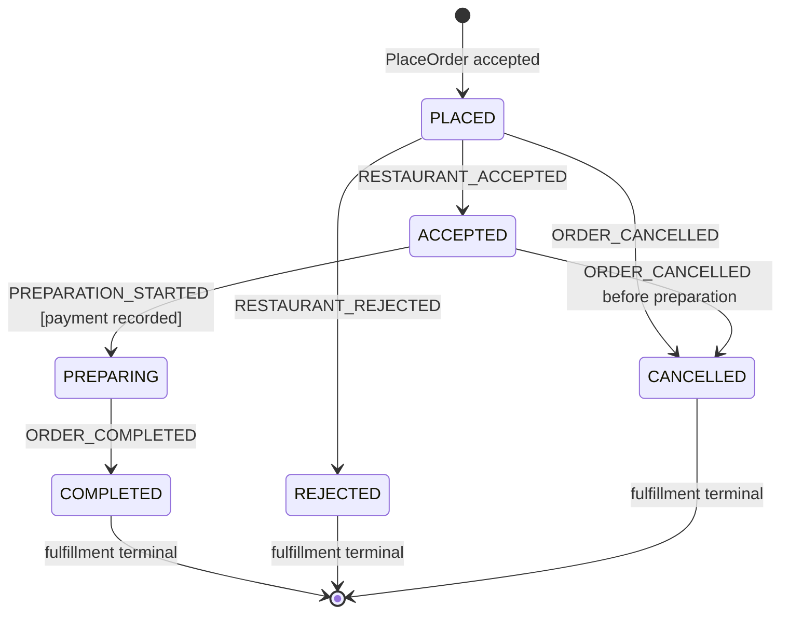

# C1.1-P06 — State machine and orthogonal workflow actions



**Self-state milestone actions (do not change fulfillment state):**

- `PAYMENT_RECORDED` in PLACED or ACCEPTED, once.
- `REFUND_REQUESTED` in CANCELLED or REJECTED only, after recorded payment, once.

**Illegal examples:** COMPLETED → ACCEPTED, CANCELLED → PREPARING and REJECTED → COMPLETED. The domain method throws a typed transition rejection *before* constructing a successor, so the application does not save a denied representation in its normal synchronous path.

This diagram covers one *fulfillment* state machine; it is not the full multi-participant workflow from P05. It does not represent provider payment settlement or independent refund execution. Concurrent acceptance/cancellation remains unsafe in this checkpoint.

```text
Customer/restaurant command
  → OrderWorkflowUseCase (application)
  → findCurrentById(OrderId)
  → Order domain transition (source, trigger, guard)
       ├─ illegal → InvalidOrderTransitionException
       │           → no new occurrence, no save
       └─ legal   → new Order instance, same ID, new fulfillment status
                   + exactly one workflow occurrence
                   → saveCurrent(updated)
                   → OrderSnapshot
```
